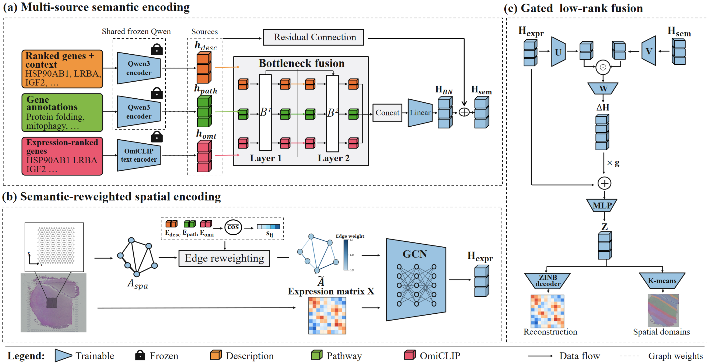

# MSSG

Multi-source semantic-guided spatial domain identification from gene expression
and spatial coordinates.



## Code structure

```text
models/              Semantic-reweighted spatial encoding, bottleneck fusion,
                     gated low-rank residual fusion, and reconstruction decoder
preprocessing/       DLPFC/HBC preprocessing and semantic spatial-edge reweighting
feature_extraction/  Description, Pathway, and OmiCLIP features
losses.py            Reconstruction, pair-mean spatial, and local contrastive losses
utils.py             Shared utilities
requirements.txt     Dependencies
```

The model uses one spatial GCN. Build its fixed normalized graph with
`preprocessing.graph.semantic_reweighted_spatial` using the frozen semantic
sources before model-side centering. The original binary neighbor masks are
retained for the spatial and contrastive objectives.

## Installation

Verified with Python 3.12.7 and PyTorch CUDA 12.1. The dependency versions below
match the local verification environment; a fresh installation is not yet tested.

```bash
pip install -r requirements.txt
```

## Inputs

- Each dataset directory contains `filtered_feature_bc_matrix.h5`, `spatial/`,
  and `metadata.tsv` indexed by spot barcode. DLPFC uses `layer_guess_reordered`;
  HBC uses `ground_truth` (annotation prefixes D/H/I/T).
- `prepare_data` returns AnnData with expression in `X`, coordinates in
  `obsm["spatial"]`, raw adjacency in `obsm["sadj"]`, and binary loss masks in
  `obsm["graph_nei"]` and `obsm["graph_neg"]`.
- Supply three finite float32 semantic arrays in Description, Pathway, OmiCLIP
  order. Their rows must match `adata.obs_names` exactly. Generate semantic
  inputs from the intended gene-expression matrix before HVG restriction.
- Reuse one frozen Qwen model for Description and Pathway. Qwen/OmiCLIP weights
  and any housekeeping-gene list are supplied separately. Pass all model and
  graph settings explicitly; the final paper preset is not bundled.

## Release status

This is a partial source release. Final configurations, model weights, and full
training and reproduction scripts will be provided after paper acceptance.

## Acknowledgments

Semantic feature extraction uses the
[Loki/OmiCLIP](https://github.com/GuangyuWangLab2021/Loki) text encoder.
The local contrastive objective follows the neighborhood-readout and bilinear
scoring approach used in [GraphST](https://github.com/JinmiaoChenLab/GraphST).
